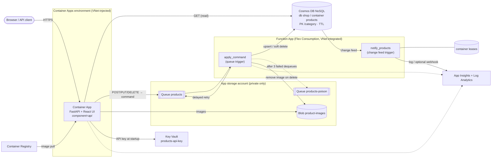
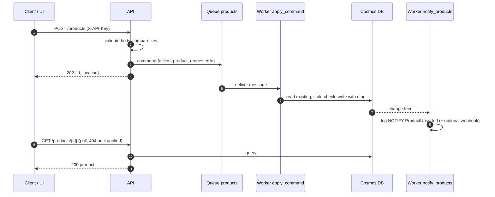

# Products demo app: architecture

Source workload for the Azure → Leaseweb migration demo. It is small on purpose, but it uses the usual building blocks of a cloud-native app (container, serverless function, NoSQL database, object storage, queue, secrets, identity, private networking), so the migration mapping has something real to cover.

## 1. Overview

A catalog of products with a REST API and a web UI.

- **Reads** are synchronous and go straight to the database.
- **Writes** are asynchronous. The API validates the request, puts a command on a queue and returns `202 Accepted`. A background worker applies the command to the database.
- **Images** go to object storage.
- **Change notifications** are emitted from the database change feed.



## 2. Components

| Component | Tech | Responsibility | `component` tag |
|---|---|---|---|
| **API + UI** | FastAPI (Python 3.11) on Azure Container Apps, 1–3 replicas, HTTP scale rule at 50 concurrent requests. The React (Vite) UI is built into the same image and served at `/` (hash routing, so it never collides with API paths). | REST API, request validation, API-key check, enqueueing commands, image upload and download, serving the UI | `api` |
| **Worker** | Azure Functions, Python v2 model, Flex Consumption (`FC1`) | `apply_command` applies queue commands to Cosmos DB. `notify_products` reacts to the change feed. | `worker` |
| **Database** | Cosmos DB NoSQL (serverless), Session consistency | Product documents. Partition key `/category`, container TTL enabled (default `-1`). A `leases` container serves the change feed trigger. | `database` |
| **App storage** | Storage account (LRS, private only) | Queue `products` (commands), queue `products-poison` (dead letters), blob container `product-images` (versioned, 7-day delete retention) | `app-storage` |
| **Function runtime storage** | Separate storage account (private only) | Functions host state and the deployment package container `deployments` | `function-runtime` |
| **Secrets** | Key Vault (RBAC mode) | `products-api-key`, generated by Terraform | `secrets` |
| **Registry** | Azure Container Registry (Basic, admin disabled) | API image, built with `az acr build` | `registry` |
| **Container platform** | Container Apps environment, Log Analytics | Hosting and logs for the API | `container-platform`, `monitoring` |
| **Observability** | Application Insights (workspace-based) | Traces and telemetry for the API (OpenTelemetry) and the worker | `monitoring` |
| **Identity** | 2 user-assigned managed identities (`api`, `worker`) | All service-to-service authentication | `identity` |
| **Network** | Existing VNet `vnet-hack` plus 3 new subnets, NSG, private endpoints, private DNS zones | See section 6 | `network` |

All resources also carry `workload=products-demo`, `environment=hackathon`, `managed-by=terraform`.

## 3. API surface

| Method | Path | Auth | Behaviour |
|---|---|---|---|
| GET | `/products?category=&limit=` | none | Cosmos query. Single-partition when `category` is given, cross-partition otherwise. Soft-deleted items are filtered out. |
| GET | `/products/{id}` | none | Read. `404` if missing **or not yet processed**. |
| POST | `/products` | `X-API-Key` | Generates the id, enqueues an `upsert`, returns `202` |
| PUT | `/products/{id}` | `X-API-Key` | Update-only (`404` if missing). A category change is sent as one command with `previousCategory`. |
| DELETE | `/products/{id}` | `X-API-Key` | Enqueues a `delete` (soft delete) |
| PUT / GET | `/products/{id}/image` | key (PUT only) | Raw `image/*` bytes, max 5 MB, stored under the product id |
| GET | `/healthz`, `/docs`, `/` | none | Health probe, Swagger UI, React UI |

Write endpoints take `?simulate=transient|poison` to exercise the failure paths.

## 4. Key flows

### 4.1 Write path (create or update)



The UI hides this asynchrony. After a write it polls `GET /products/{id}` every 3s and shows "Queued… / Applying… / Deleting…" until the change is visible. After 90s it warns that the command may be in the poison queue.

### 4.2 Failure handling

| Case | What happens |
|---|---|
| **Transient** (Cosmos 408/429/449/500/503, etag conflict, simulated) | The worker re-enqueues a copy with a visibility timeout of 10s, 20s, 40s (`RETRY_BASE_SECONDS × 2^n`), up to `MAX_SCHEDULED_RETRIES` (3). The original message is deleted. |
| **Permanent** (bad command, simulated poison) | The worker raises. The Functions runtime retries up to `maxDequeueCount` (3), then moves the message to `products-poison`. |
| **Retries exhausted** | Raised as above, so it ends in `products-poison`. |

### 4.3 Ordering and idempotency

Delayed retries and rapid successive edits can arrive out of order, so every command carries `requestedAt`:

- A command older than the stored document's `requestedAt` is skipped (stale).
- An equal timestamp means the same command re-processed, so it is applied again. This is idempotent.
- Writes use Cosmos etags (`IfNotModified`), and `create_item` fails on a concurrent create. Both cases become transient errors, so the command is retried and re-evaluated.

### 4.4 Delete and TTL

A delete is a **soft delete**: the document gets `deleted=true`, `deletedAt` and `ttl=60`. The change feed then sees it and emits `ProductDeleted`, and Cosmos TTL purges it. The worker also deletes the blob image. Reads filter on `NOT IS_DEFINED(c.deleted)`. A product can also carry its own `ttlSeconds` (stored as `ttl`) to expire by itself, for example a promo.

### 4.5 Category change (partition move)

`category` is the partition key, so a change is a move. The API sends **one** command with `previousCategory`. The worker writes the new partition first, then soft-deletes the old document with `movedTo`, so a failure never loses the product. The notifier skips the old copy so consumers see a single `ProductUpserted`.

## 5. Data model

Cosmos container `products` (partition key `/category`):

```json
{
  "id": "uuid",
  "name": "VPS Small",
  "category": "compute",
  "price": 9.99,
  "stock": 100,
  "description": "",
  "requestedAt": "ISO-8601 UTC (ordering guard)",
  "updatedAt": "ISO-8601 UTC",
  "ttl": 120,
  "deleted": true, "deletedAt": "…", "movedTo": "…"
}
```

`ttl`, `deleted`, `deletedAt` and `movedTo` are optional. The images live in Blob storage, keyed by product id. Queue messages are plain-text JSON (`messageEncoding: none` in `host.json`).

## 6. Security and networking

**Identity.** The API and the worker each have their own user-assigned managed identity. There are no connection strings or keys in app settings, and Cosmos local (key) auth is disabled. The only secret is the API key in Key Vault. Terraform generates it, so it is also in Terraform state: keep state private.

| Identity | Role | Scope |
|---|---|---|
| api | Storage Blob Data Contributor, Storage Queue Data Message Sender | app storage |
| api | Key Vault Secrets User | Key Vault |
| api | AcrPull | registry |
| api | Cosmos DB Built-in Data Reader | Cosmos account |
| worker | Storage Queue Data Contributor, Storage Blob Data Contributor | app storage |
| worker | Blob Data Owner, Queue Data Contributor, Table Data Contributor | function runtime storage |
| worker | Cosmos DB Built-in Data Contributor | Cosmos account |

**Network.** Both storage accounts are private only: public network access is disabled and the default firewall action is `Deny`.

- The Container Apps environment is injected into subnet `…-cae`.
- The Function app uses VNet integration with subnet `…-func`.
- Private endpoints in subnet `…-pe`, resolved through `privatelink.*.core.windows.net` private DNS zones linked to the VNet, give both apps access to storage.
- Terraform manages only the subnets, NSG, zones and endpoints, never the VNet itself.
- Cosmos DB and Key Vault are reached over their public endpoints, authenticated with Entra ID. The API's ingress is external.

The API compares the `X-API-Key` header in constant time, and write endpoints return `401` otherwise.

## 7. Deployment

Terraform (`infra/`, azurerm 4.x) creates everything. `scripts/deploy.ps1` runs a two-phase deploy because the Container App needs an image that must exist first:

1. `terraform apply` for all infrastructure, without the Container App (`api_image` empty).
2. `az acr build api/` builds the image in the cloud (multi-stage: Node builds the UI, Python serves API and UI).
3. `terraform apply -var=api_image=…` creates the Container App.
4. The worker is zip-deployed to the Function app with a remote build.

`terraform apply` alone never builds or updates the image. A new image tag has to be passed in.

## 8. Observability

- Application Insights is connected for both apps. The API uses `azure-monitor-opentelemetry` when the connection string is set. The worker has sampling disabled.
- The notifier logs `NOTIFY {json}`, so check App Insights traces with `message startswith 'NOTIFY'`. It can also POST to `NOTIFY_WEBHOOK_URL`, best-effort.
- Poison messages are visible in the `products-poison` queue in the portal.

## 9. Design decisions and trade-offs

| Decision | Why | Trade-off |
|---|---|---|
| Queue between API and database | Decouples the API from database availability and shows retry, DLQ and ordering patterns | Eventual consistency. A 404 right after a 202 is expected, and there is no status endpoint. |
| Soft delete plus TTL | Lets the change feed observe deletes | Deleted docs exist for ~60s. |
| `PUT` by id uses a cross-partition lookup | Simple for a demo-sized catalog | Cost grows with data. Use `read_item` when the category is known. |
| Single container for API and UI | One image, one deployment, no CORS | UI changes need an image rebuild. |
| Serverless Cosmos, Flex Consumption | Pay per use, scale to zero | Cold starts on the worker. |
| Private-only storage | Policy requirement | The API cannot reach queue or blob from a developer machine. |

## 10. Local development

The storage accounts are private only, so a locally run API **cannot** reach the queue or blobs, even with the right roles and `az login`. It can only work from inside the VNet. Test against the deployed Container App, or temporarily allow your IP on the storage firewall. Local Cosmos and Key Vault access need your user to hold the matching data roles.

UI-only work is simple: `npm run dev` in `api/ui` proxies to whichever API is reachable on port 8000.

## 11. Migration view (Azure → Leaseweb)

Each resource has a `component` tag, so a migration tool can group them. A starting point for the mapping:

| Azure | Leaseweb direction (see `leaseweb-api/`) | Notes |
|---|---|---|
| Container App, Container Registry | Public Cloud instance (container runtime) | The image is portable, and the registry has to be replaced. |
| Function App | Public Cloud instance running the same code | The queue and change-feed triggers need replacing with polling workers. |
| Storage queue | Needs replacement | Leaseweb has no managed queue, so use a broker on an instance. |
| Blob storage | Object Storage (S3-compatible) | Bucket plus access keys. |
| Cosmos DB NoSQL | Self-hosted database on an instance | No managed Cosmos equivalent. The change feed has to be redesigned. |
| Key Vault, managed identities | Secrets in the app or environment | Managed identity has no equivalent. |
| VNet, subnets, private endpoints, NSG | Private Network, Security Group | |

This table is a hypothesis to validate against the Leaseweb OpenAPI definitions, not a confirmed mapping.
